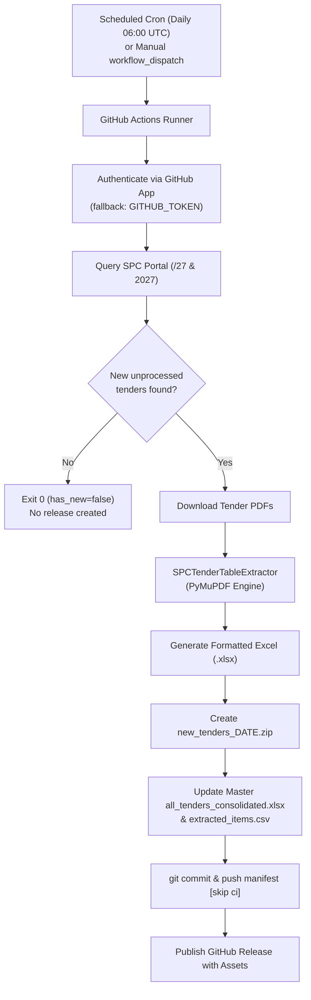

# 🏥 SPC Tenders — Automated Daily Extraction & Release Pipeline

[](https://github.com/budd9442/spc-tenders/actions/workflows/daily_sync.yml)
[](https://github.com/budd9442/spc-tenders/releases/latest)
[](https://github.com/budd9442/spc-tenders/releases)
[](https://github.com/budd9442/spc-tenders/releases)
[](https://www.python.org/)
[](LICENSE)

An enterprise-grade, automated data pipeline that continuously monitors the **State Pharmaceuticals Corporation (SPC) of Sri Lanka** tender portal, detects newly published pharmaceutical and surgical tenders, extracts structured Schedule of Requirements tables from complex multi-page PDF specifications, and publishes daily zip archives and consolidated datasets via GitHub Releases.

---

## ⚡ Key Highlights

- **Daily Automated Synchronization**: A scheduled GitHub Actions workflow checks the live SPC portal every day at **06:00 UTC** (11:30 AM Sri Lanka Standard Time).
- **Zero-Waste Delta Extraction**: Detects newly published tenders against the repository manifest. If no new tenders are published, the action exits cleanly without triggering empty releases.
- **Automated GitHub Releases**: When new tenders are discovered, the workflow extracts all tables, packages them into a `new_tenders_<DATE>.zip` archive, updates the master consolidated Excel sheet and CSV, and publishes a tagged GitHub Release.
- **Calibrated Extraction Engine**: Custom coordinate calibration engine built on PyMuPDF handles:
  - 8-digit MSD SR code anchor detection.
  - Sub-pixel word-level footer cutoff to prevent notes from leaking into item rows.
  - Multi-page specification continuation for long drug monographs.
  - General Order Condition (GOC) marker protections.
- **Stylized Excel Workbooks**: Individual `.xlsx` workbooks with official SPC header palettes, metadata blocks, and auto-fitted columns, plus a 4-tab master consolidated workbook (`All_Items`, `DHS_SA_Items`, `DHS_SS_Items`, `Tenders_Catalog`).
- **Flexible Authentication**: Out-of-the-box support for **GitHub App** authentication (`APP_ID` / `APP_PRIVATE_KEY`), with automatic fallback to standard `GITHUB_TOKEN`.

---

## 📦 Releases & Complete Historical Archive

| Release | Description | Assets Included |
| :--- | :--- | :--- |
| **[Latest Daily Release](https://github.com/budd9442/spc-tenders/releases/latest)** | Daily delta release containing newly detected tenders. | `new_tenders_<DATE>.zip`, `all_tenders_consolidated.xlsx`, `extracted_items.csv` |
| **[Initial Baseline Archive](https://github.com/budd9442/spc-tenders/releases/tag/v2026.10.14)** | Full historical dataset of all **569 tenders** and **4,866 line items**. | `tables_xlsx.zip` (4.8 MB), `all_tenders_consolidated.xlsx` (1.3 MB), `extracted_items.csv` (2.0 MB) |

---

## 🏗️ System Architecture



---

## 📊 Extracted Data Schema

Every extracted line item conforms to the following standardized schema:

| Column | Type | Example | Description |
| :--- | :--- | :--- | :--- |
| `tender_no` | String | `DHS/SS/ICB/26/27` | Standardized procurement number |
| `category` | String | `DHS/SS` or `DHS/SA` | Surgical (`DHS/SS`) or Pharmaceutical (`DHS/SA`) |
| `order_list_no` | String | `2027/SPC/N/R/S/00001` | Medical Supplies Division (MSD) Order List Number |
| `closing_date` | String | `27-03-2026 09:00 am` | Tender closing date and time |
| `item_no` | String | `1` | Sequential item number within the tender |
| `sr_no` | String | `15000001` | 8-digit MSD State Requirement (SR) code |
| `description` | Text | `Radiotherapy Room Device, Table Strap...` | Full item specification and formulation |
| `quantity` | String | `9 Nos` | Required quantity with pack unit |
| `delivery_schedule` | String | `09 Jan/2027` | Multi-staggered delivery schedule |
| `bid_bond` | String | `LKR 279,870.00 USD 904.38` | Required bid security value |
| `page` | Integer | `3` | Source page number in the original tender PDF |
| `source_file` | String | `DHS_SS_ICB_26_27.pdf` | Name of the source PDF document |

---

## ⚙️ GitHub Actions & App Setup

### Default Setup (Zero Configuration)
The included workflow [`.github/workflows/daily_sync.yml`](.github/workflows/daily_sync.yml) runs automatically using the default `GITHUB_TOKEN` provided by GitHub Actions with `contents: write` permissions.

### Optional: Using a GitHub App (Recommended for Organization Automation)
Using a GitHub App allows commits and releases to bypass branch protection rules and trigger downstream workflows.

1. Create a GitHub App in your GitHub Account/Org (**Settings > Developer Settings > GitHub Apps > New GitHub App**).
2. Set permissions:
   - **Repository contents**: Read & Write.
3. Generate a Private Key (`.pem` file) and note the **App ID**.
4. Install the App on the `budd9442/spc-tenders` repository.
5. In your repository settings (**Settings > Secrets and variables > Actions**), add:
   - `APP_ID`: The App ID number (e.g. `123456`).
   - `APP_PRIVATE_KEY`: The entire contents of the `.pem` private key file.

The workflow automatically detects these secrets; if present, it uses the GitHub App token. If absent, it seamlessly falls back to `GITHUB_TOKEN`.

---

## 💻 Local Development & Manual Execution

### 1. Installation
Clone the repository and install dependencies in a virtual environment:

```bash
git clone https://github.com/budd9442/spc-tenders.git
cd spc-tenders

python3 -m venv .venv
source .venv/bin/activate
pip install -r requirements.txt
```

### 2. Check for New Tenders (Dry-Run Mode)
Check the live SPC portal without downloading PDFs or writing files:

```bash
python run_sync.py --dry-run
```

### 3. Run Full Synchronization
Run the full sync pipeline locally (downloads new PDFs, extracts tables, and creates release assets in `output/`):

```bash
python run_sync.py
```

### 4. Rebuild Consolidated Master Files
Rebuild `all_tenders_consolidated.xlsx` and `extracted_items.csv` from existing dataset records:

```bash
python run_sync.py --force-rebuild
```

---

## 📂 Repository Structure

```text
spc-tenders/
├── .github/
│   └── workflows/
│       └── daily_sync.yml         # GitHub Actions daily schedule & release workflow
├── data/
│   ├── manifest.json              # Catalog of all processed tenders (569 tenders)
│   ├── extracted_tenders.jsonl    # Line-delimited JSON of all extracted tender items
│   └── extracted_items.csv        # Consolidated CSV of all 4,866 line items
├── src/
│   ├── __init__.py                # Package root
│   ├── scraper.py                 # Live portal query and pagination discovery
│   ├── extractor.py               # Calibrated PyMuPDF table extraction engine
│   └── excel_builder.py           # Individual & consolidated Excel formatting
├── run_sync.py                    # Main pipeline entrypoint & CLI
├── requirements.txt               # Python package dependencies
├── .gitignore                     # Git exclusion rules
├── LICENSE                        # MIT License
└── README.md                      # Comprehensive project documentation
```

---

## 📄 License

This project is licensed under the MIT License — see the [LICENSE](LICENSE) file for details.
All original tender notices and specifications are the property of the State Pharmaceuticals Corporation of Sri Lanka and Ministry of Health.
